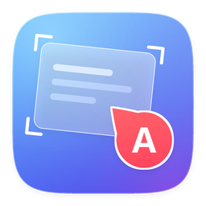

<p align="center">
  
</p>

<h1 align="center">SnapMark</h1>

<p align="center">
  <b>Screenshots that explain themselves.</b><br>
  Mark up a screenshot with A-B-C markers and comments, copy a whole series with one Ctrl+C,
  paste images <i>and</i> text into any chat — and record your screen with sound.
</p>

<p align="center">
  <a href="https://github.com/KantemirBitokov/SnapMark/releases/latest"><b>⬇ Download</b></a> ·
  Windows · macOS · Linux · free &amp; open source ·
  <a href="README.ru.md">Русский</a>
</p>

<!--
  Media to record (see docs/media/README.md) — uncomment when the files are in place:
  <p align="center"></p>
-->

---

## Why SnapMark

Writing a bug report, explaining a UI change, or giving feedback usually means: take a screenshot,
draw arrows somewhere, then type “the button on the left… no, the other one”.
SnapMark puts **lettered markers right on the screenshot** and turns your comments into text:

```
Screenshot_1_A — Button doesn't respond
Screenshot_1_B — Typo in the heading
Screenshot_2_A — Wrong indent
```

Press **Ctrl+C** once — and **Ctrl+V** pastes the screenshots *and* this text into Slack, Telegram,
ChatGPT/Claude, Jira, Word or an email. No more pasting images and text separately.

## Features

**Capture**
- Region or full screen on <kbd>PrtSc</kbd> (customizable hotkeys); works across multiple monitors with different scaling
- Clean macOS-style selection frame with your color of choice

**Annotate**
- **Markers** A, B, C… or 1, 2, 3 — circle, rounded square, diamond or pin, with or without an arrow; per-marker colors
- **Comments** for each marker — copied as text, optionally drawn on the image with their own font and frame
- Pen with pressure/speed-sensitive width, pencil, highlighter, eraser
- Hold the stroke to snap it into a clean line, arrow, rectangle or ellipse
- Lines, arrows, double arrows, rectangles, ellipses (filled — e.g. to hide private data)
- Text with any font, weight, size, color, frame/plate and shadow
- Every object has its own little style panel; undo/redo, duplicate, delete

**Share**
- **Series mode** — collect several screenshots with comments and copy everything at once
- **Smart paste** (Windows) — one Ctrl+V gives each app what it understands: images then text in chats, images with captions in Word/Outlook, files in Explorer
- Save as PNG / JPG / WebP / BMP, print, search the image on Google Lens

**Record**
- Record a region or the full screen to MP4, MKV, WebM or GIF, 15–60 fps
- Microphone, computer audio or both — with device selection and a mic level test
- No time limit; crash-safe recording (nothing is lost if the PC freezes)

**Everywhere**
- Windows 10/11, macOS 11+ (Apple Silicon & Intel), Linux (X11; Wayland with limitations)
- English, Русский, Deutsch, Français, Italiano, Español
- Lives quietly in the tray / menu bar

## Download

Get the latest version from **[Releases](https://github.com/KantemirBitokov/SnapMark/releases/latest)**:

| System | File |
|---|---|
| Windows 10/11 | `SnapMark-…-Setup.exe` (installer, no admin rights needed) or `…-portable.zip` |
| macOS — Apple Silicon (M1–M4) | `SnapMark-…-macOS-arm64.dmg` |
| macOS — Intel | `SnapMark-…-macOS-x64.dmg` |
| Linux — any distro | `SnapMark-…-linux-x64.AppImage` |
| Ubuntu / Debian / Mint | `snapmark_…_amd64.deb` |

Video recording uses the free **ffmpeg** encoder. On Windows SnapMark downloads it for you in one click;
on macOS run `brew install ffmpeg`, on Linux `sudo apt install ffmpeg`.

### First launch

SnapMark is free and not (yet) signed with a paid certificate, so the system asks once:

- **Windows** — “Windows protected your PC” → **More info** → **Run anyway**.
- **macOS** — right-click SnapMark.app → **Open** → **Open**. If macOS says the app is “damaged”, run
  `xattr -cr /Applications/SnapMark.app` once in Terminal. Then allow **Screen Recording** in
  System Settings → Privacy & Security.
- **Linux AppImage** — `chmod +x SnapMark-*.AppImage` and run it.

## Hotkeys

| Action | Windows / Linux | macOS |
|---|---|---|
| Region screenshot | <kbd>PrtSc</kbd> | <kbd>⌘</kbd><kbd>⇧</kbd><kbd>1</kbd> |
| Full screen | <kbd>Shift</kbd>+<kbd>PrtSc</kbd> | <kbd>⌘</kbd><kbd>⇧</kbd><kbd>2</kbd> |
| Record video (start/stop) | <kbd>Ctrl</kbd>+<kbd>PrtSc</kbd> | <kbd>⌘</kbd><kbd>⇧</kbd><kbd>9</kbd> |

In the editor: <kbd>Ctrl+C</kbd> copy · <kbd>Ctrl+S</kbd> save · <kbd>Ctrl+D</kbd> add to series ·
<kbd>Ctrl+Z</kbd> undo · <kbd>M</kbd> marker · <kbd>T</kbd> text · <kbd>P</kbd> pen · <kbd>A</kbd> arrow · <kbd>Esc</kbd> close.

On Wayland (and anywhere you prefer system shortcuts) bind a key to a command:
`snapmark --region`, `--full`, `--record`, `--series`, `--settings`.

## Building from source

.NET 8 + Avalonia UI. Open `SnapMark.sln` in Visual Studio 2022 or run
`dotnet run --project src/SnapMark.App`. Details, release scripts and architecture: **[docs/BUILDING.md](docs/BUILDING.md)**.

## Feedback

Found a bug or have an idea? [Open an issue](https://github.com/KantemirBitokov/SnapMark/issues/new/choose) —
a SnapMark screenshot with markers is the perfect bug report 🙂
Translations into more languages are welcome: all texts live in [`Strings.tsv`](src/SnapMark.Core/Strings.tsv).

## License

[MIT](LICENSE) © Kantemir Bitokov · [SadlyBear.pro](https://sadlybear.pro)
