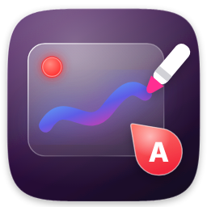
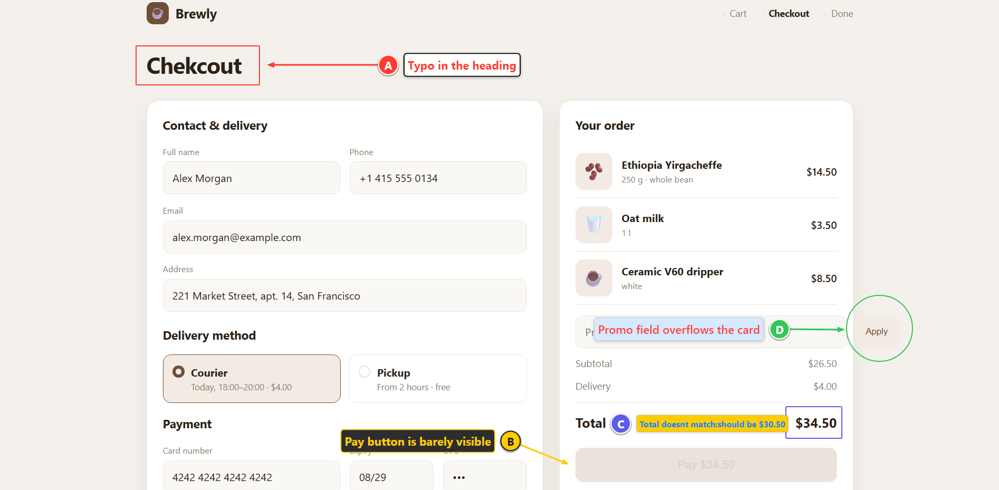
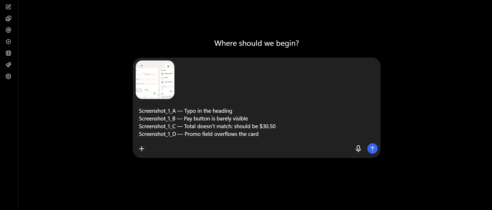
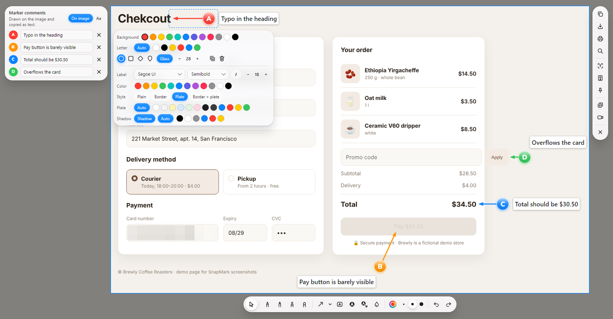
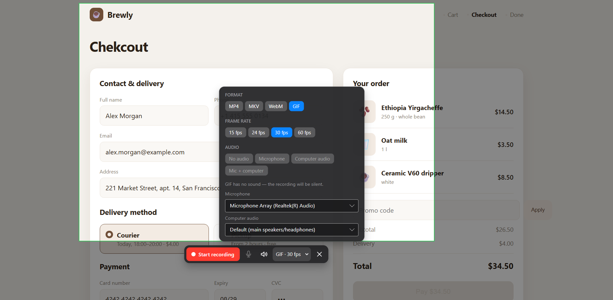

<p align="center">
  
</p>

<h1 align="center">SnapMark</h1>

<p align="center">
  <b>Скриншоты, которые объясняют сами себя.</b><br>
  Метки A-B-C с комментариями прямо на скриншоте, серия одним Ctrl+C,
  вставка картинок <i>и</i> текста в любой чат — и запись экрана со звуком.
</p>

<p align="center">
  <a href="https://github.com/KantemirBitokov/SnapMark/releases/latest"><b>⬇ Скачать</b></a> ·
  Windows · macOS · Linux · бесплатно, открытый код ·
  <a href="README.md">English</a>
</p>

<p align="center"></p>
<p align="center"><sub>Метки с комментариями прямо на скриншоте</sub></p>

---

## Зачем

Баг-репорт, правки по макету, объяснение коллеге — обычно это скриншот, стрелки «где-то тут»
и переписка «кнопка слева… нет, другая». В SnapMark ставишь **метки с буквами прямо на скриншоте**,
пишешь к ним комментарии — и они превращаются в текст:

```
Screenshot_1_A — Кнопка не нажимается
Screenshot_1_B — Опечатка в заголовке
Screenshot_2_A — Сдвинут отступ
```

Один **Ctrl+C** — и **Ctrl+V** вставит и скриншоты, и этот текст в Telegram, Slack, ChatGPT/Claude,
Jira, Word или письмо. Не нужно вставлять картинки и текст по отдельности.

## Возможности

**Захват** — область или весь экран по <kbd>PrtSc</kbd> (клавиши настраиваются), несколько мониторов с разным масштабом, аккуратная рамка выделения в стиле macOS.

**Разметка**
- **Метки** A, B, C… или 1, 2, 3 — круг, скруглённый квадрат, ромб, булавка; со стрелкой или без; свои цвета у каждой
- **Комментарии** к меткам — копируются текстом, по желанию рисуются на картинке своим шрифтом и в рамке
- Перо с толщиной от скорости и нажима, карандаш, маркер, ластик
- Задержи линию в конце — станет ровной стрелкой, прямоугольником или эллипсом
- Линии, стрелки, прямоугольники, эллипсы (с заливкой — чтобы скрыть личные данные)
- Текст любым шрифтом, начертанием, цветом, в рамке/на подложке, с тенью
- **Скрыть** — размытие или пиксели для паролей, почты и лиц; исходные пиксели в сохранённую картинку не попадают
- У каждого объекта своя панель стиля; отмена/повтор, дублирование, удаление

**Пошаговая инструкция одной кнопкой** — нажми сочетание и работай как обычно: каждый клик становится скриншотом с меткой A, B, C, указывающей, куда нажали, и подписью с названием окна. «Готово» — вся инструкция в буфере, вставляется одним Ctrl+V в чат, документ или Word.

**Текст с экрана (OCR)** — выдели область, и текст сразу в буфере; без интернета (Windows OCR, Vision на macOS, tesseract в Linux). **Закрепить скриншот** поверх всех окон: двигай, масштабируй колесом, Ctrl+колесо — прозрачность. **Длинный скриншот** — выдели прокручиваемую часть страницы или документа, SnapMark сам прокрутит и склеит её (закреплённые шапки — один раз).

**Отправка** — режим серии, умная вставка (Windows), сохранение в PNG/JPG/WebP/BMP, печать, поиск по картинке в Google Lens.

**Запись видео** — область или весь экран, MP4/MKV/WebM/GIF, 15–60 кадров, микрофон и/или звук компьютера, тест микрофона, без ограничения длины, запись не теряется при сбое.

**Для обучающих роликов** — подсветка кликов и показ нажатых сочетаний клавиш прямо в видео (обычный набор текста не показывается), **камера в углу** видео, **обрезка после записи и экспорт в GIF** (жёлтые ручки на ленте кадров, 10–24 кадров/с, любая ширина).

**Рисование прямо во время записи** — перо, маркер, стрелки, фигуры, метки A-B-C с комментариями и текст появляются в видео по мере того, как рисуешь и печатаешь; переключись на мышь — и продолжай работать в программах. Стили — как в редакторе (шрифты, рамки, тени…), а панели программы в видео не попадают.

**Качество и размер записи** — от «Низкого» до «Максимального»; точный размер области: 1280×720, 1920×1080, квадрат, вертикальное 1080×1920 или любой Ш × В.

**Везде** — Windows 10/11, macOS 11+ (Apple Silicon и Intel), Linux; 6 языков интерфейса; живёт в трее.

## Скриншоты

| | |
|---|---|
|  |  |
| Один Ctrl+V — картинка и комментарии приходят вместе | У каждого объекта своя панель стиля |
|  | |
| Запись экрана: формат, кадры, звук и устройства | |

## Скачать

Последняя версия — во вкладке **[Releases](https://github.com/KantemirBitokov/SnapMark/releases/latest)**:

| Система | Файл |
|---|---|
| Windows 10/11 | `SnapMark-…-Setup.exe` (установщик, без прав администратора) или `…-portable.zip` |
| macOS — Apple Silicon (M1–M4) | `SnapMark-…-macOS-arm64.dmg` |
| macOS — Intel | `SnapMark-…-macOS-x64.dmg` |
| Linux — любой дистрибутив | `SnapMark-…-linux-x64.AppImage` |
| Ubuntu / Debian / Mint | `snapmark_…_amd64.deb` |

**macOS через Homebrew:** `brew install --cask kantemirbitokov/tap/snapmark`

Для записи видео нужен бесплатный **ffmpeg**: на Windows SnapMark скачает его сам в один клик,
на Mac — `brew install ffmpeg`, в Linux — `sudo apt install ffmpeg`.

### Первый запуск

Программа бесплатная и пока не подписана платным сертификатом, поэтому система один раз переспросит:

- **Windows** — «Windows защитила ваш компьютер» → **Подробнее** → **Выполнить в любом случае**.
- **macOS** — правый клик по SnapMark.app → **Открыть** → **Открыть**. Если macOS пишет «повреждено» —
  один раз выполни в Терминале `xattr -cr /Applications/SnapMark.app`. Потом разреши **Запись экрана**
  в Системных настройках → Конфиденциальность и безопасность.
- **Linux AppImage** — `chmod +x SnapMark-*.AppImage` и запусти.

## Горячие клавиши

| Действие | Windows / Linux | macOS |
|---|---|---|
| Скриншот области | <kbd>PrtSc</kbd> | <kbd>⌘</kbd><kbd>⇧</kbd><kbd>1</kbd> |
| Весь экран | <kbd>Shift</kbd>+<kbd>PrtSc</kbd> | <kbd>⌘</kbd><kbd>⇧</kbd><kbd>2</kbd> |
| Запись видео (старт/стоп) | <kbd>Ctrl</kbd>+<kbd>PrtSc</kbd> | <kbd>⌘</kbd><kbd>⇧</kbd><kbd>9</kbd> |
| Пошаговая инструкция (старт/готово) | <kbd>Ctrl</kbd>+<kbd>Shift</kbd>+<kbd>PrtSc</kbd> | <kbd>⌘</kbd><kbd>⇧</kbd><kbd>8</kbd> |

В редакторе: <kbd>Ctrl+C</kbd> копировать · <kbd>Ctrl+S</kbd> сохранить · <kbd>Ctrl+D</kbd> в серию ·
<kbd>Ctrl+T</kbd> текст с картинки · <kbd>Ctrl+F</kbd> закрепить поверх окон · <kbd>Ctrl+L</kbd> длинный скриншот · <kbd>Ctrl+Z</kbd> отмена · <kbd>M</kbd> метка · <kbd>T</kbd> текст · <kbd>P</kbd> перо · <kbd>A</kbd> стрелка · <kbd>B</kbd> скрыть · <kbd>Esc</kbd> закрыть.

Под Wayland (и везде, где удобнее системные сочетания) назначь клавишу на команду:
`snapmark --region`, `--full`, `--record`, `--steps`, `--series`, `--settings`.

## Сборка из исходников

.NET 8 + Avalonia UI. Открой `SnapMark.sln` в Visual Studio 2022 или `dotnet run --project src/SnapMark.App`.
Подробности, скрипты релиза и устройство проекта — **[docs/BUILDING.md](docs/BUILDING.md)**.

## Обратная связь

Нашёл ошибку или есть идея? [Создай issue](https://github.com/KantemirBitokov/SnapMark/issues/new/choose) —
скриншот SnapMark с метками — идеальный баг-репорт 🙂
Переводы на другие языки приветствуются: все тексты — в [`Strings.tsv`](src/SnapMark.Core/Strings.tsv).

## Лицензия

[MIT](LICENSE) © Кантемир Битоков · [SadlyBear.pro](https://sadlybear.pro)
