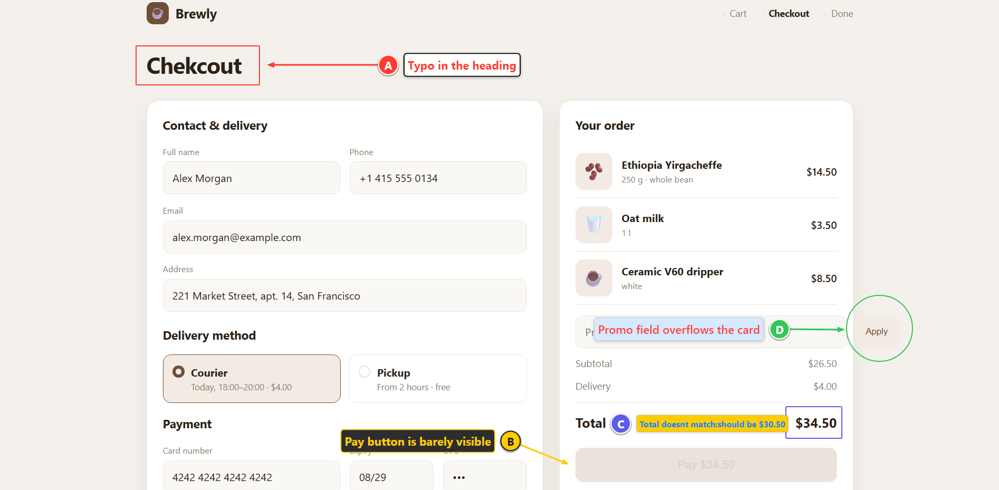
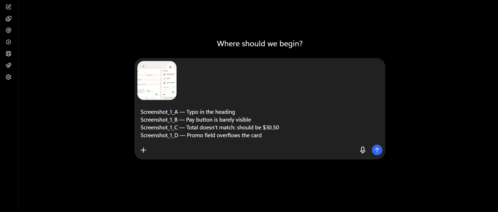
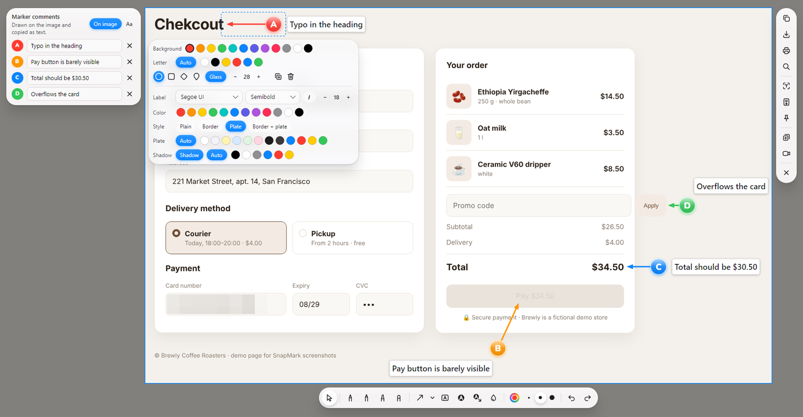
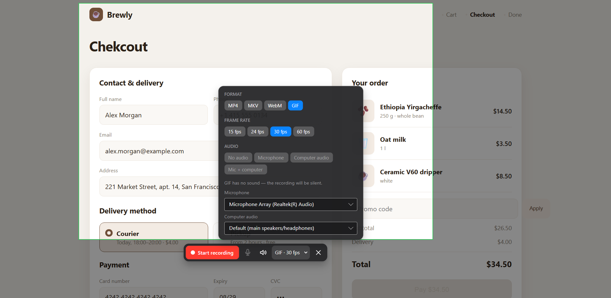

<!--
  ════════════════════ ПАМЯТКА ПЕРЕД ПУБЛИКАЦИЕЙ (это не часть статьи) ════════════════════

  Заголовок (выбери один):
    1. «Скриншотер, который пишет баг-репорт за тебя: метки A-B-C и один Ctrl+V для картинок и текста»
    2. «Как я делал скриншотер под три ОС и победил „видео длиной 200 часов“»
    3. «SnapMark: бесплатный скриншотер с метками и комментариями — что под капотом»

  Хабы: «.NET», «Разработка под Windows», «Open source», «Тестирование IT-систем», «Я пиарюсь»
    («Я пиарюсь» — обязательный хаб, если статья рассказывает о своём продукте; без него могут снять с публикации).
  Теги: скриншоты, avalonia, c#, .net, ffmpeg, wasapi, open source, баг-репорт, буфер обмена, кроссплатформенность

  Как вставить:
    • Новый редактор Хабра понимает Markdown при вставке: скопируй всё ниже линии «НАЧАЛО СТАТЬИ».
    • Картинки: если после вставки какая-то не отобразилась — удали её и загрузи файл из docs/media/
      кнопкой «Изображение» (Хабр сохраняет картинки на habrastorage, внешние ссылки иногда не принимает).
    • Блок <cut /> — это «Читать далее»: всё, что выше, видно в ленте. В редакторе это кнопка «Кат».
    • Картинка-обложка для ленты: docs/social-preview.png.

  Важно:
    • Перечитай и поправь текст своими словами — Хабр строго относится к «сгенерированным» статьям,
      а живой авторский тон читается лучше. Раздел «Как я это делал» честно говорит, что разработка
      шла вместе с ИИ-ассистентом — на Хабре это сейчас интересная тема и плюс к доверию.
    • Первая статья проходит модерацию «Песочницы» — обычно 1–3 дня.
    • Лучшее время публикации: будний день, 9:00–11:00 по Москве.
    • В первые часы отвечай на комментарии — это сильно поднимает статью в ленте.

  ═════════════════════════════════════ НАЧАЛО СТАТЬИ ═════════════════════════════════════
-->

Каждый, кто писал баг-репорт или правки по макету, знает этот ритуал: скриншот, красная стрелка «где-то тут», а потом отдельное сообщение — «кнопка слева… нет, не эта, которая под ней». Если скриншотов пять, через десять минут уже никто не помнит, какой комментарий к какой картинке.

Мне хотелось, чтобы скриншот и его объяснение всегда шли вместе. Так появился **SnapMark** — бесплатный скриншотер для Windows, macOS и Linux с открытым кодом. Ниже — что он умеет и какие неочевидные проблемы пришлось решить по дороге: от буфера обмена, который «теряет» текст, до видео, которое плееры показывали длиной в 200 часов.



<cut />

## Идея: метки вместо стрелок

Вместо «стрелки куда-то» на скриншот ставятся метки **A, B, C** (или 1, 2, 3), и к каждой пишется комментарий. При копировании комментарии превращаются в обычный текст:

```
Screenshot_1_A — Опечатка в заголовке
Screenshot_1_B — Кнопку оплаты почти не видно
Screenshot_1_C — Итог не сходится: должно быть 2 250 ₽
Screenshot_1_D — Поле промокода вылезает за карточку
```

Можно собрать **серию** из нескольких скриншотов и скопировать всё разом одним Ctrl+C — каждая строка однозначно указывает и на картинку, и на место на ней. Комментарии при желании рисуются прямо на изображении своим шрифтом, в рамке или на подложке.

## Самое сложное: один Ctrl+V для картинок и текста

Оказалось, что «положить в буфер картинку и текст» — совсем не то же самое, что «вставить картинку и текст». Буфер обмена Windows хранит много форматов одновременно, но каждое приложение при вставке забирает **один** — тот, что считает лучшим:

- веб-чаты (Telegram Web, Slack, ChatGPT) берут картинку и игнорируют текст;
- Блокнот берёт только текст;
- Word предпочитает RTF или HTML, и если там нет картинок — вставит только текст.

В итоге в чат прилетал скриншот, а комментарии терялись. Решение — **умная вставка**. SnapMark перехватывает Ctrl+V, смотрит, какое приложение сейчас активно, и подкладывает ему подходящий формат:

- **браузеры и мессенджеры** — сначала картинки, затем текст: две вставки подряд, между ними буфер подменяется;
- **Word, Outlook, WordPad** — RTF, где PNG встроены прямо между подписями (`{\pict\pngblip …}`);
- **Проводник** — файлы картинок;
- **Блокнот, VS Code, терминалы** — только текст.

Для пользователя это выглядит как один Ctrl+V, который «просто работает»:



Тонкость: перехваченное нажатие надо «вернуть» системе, если буфер за это время перезаписало другое приложение. Для этого SnapMark запоминает `GetClipboardSequenceNumber()` в момент копирования и, если номер изменился, просто пропускает Ctrl+V дальше как обычно.

## PrtSc и «Ножницы» Windows 11

В Windows 11 клавиша PrtSc по умолчанию открывает «Ножницы». `RegisterHotKey` здесь проигрывает: система обрабатывает клавишу раньше. Пришлось, как это делают ShareX и PowerToys, ставить низкоуровневый хук клавиатуры (`WH_KEYBOARD_LL`) в отдельном потоке и «глотать» нажатие.

Если «Ножницы» всё равно пробиваются, SnapMark предлагает выключить параметр Windows `PrintScreenKeyForSnippingEnabled` — и запоминает, что это сделал он. При удалении программы установщик возвращает настройку как было. Мелочь, но неприятно, когда программа после себя оставляет систему не такой, какой её нашла.

## Рисование «как на iPad»

Перо меняет толщину от скорости мыши (или от нажима, если у вас планшет). Если в конце линии задержать курсор, распознаватель фигур превращает каракули в ровную стрелку, прямоугольник или эллипс — идея подсмотрена у Markup в macOS. У каждого объекта своя панель стиля рядом с ним: цвет, шрифт, рамка, подложка, тень.



## Запись видео: как я победил «видео длиной 200 часов»

Первая версия записи передавала звук в ffmpeg «живым» потоком через pipe. Результат: плеер показывал длительность то 20, то 1000 часов, а звук обрывался через секунду. Причина — у сырого звука из pipe нет нормальных меток времени, ffmpeg ставил их по системным часам, и они расходились с видео.

Рабочая схема оказалась проще и надёжнее:

1. ffmpeg пишет **только видео** с ровной частотой кадров — во временный MKV, который не теряется, даже если компьютер завис посреди многочасовой записи;
2. звук параллельно пишется в сырой PCM через WASAPI — микрофон и loopback-захват звука системы (сырой PCM вместо WAV — потому что у WAV предел 4 ГБ, это около трёх часов);
3. запись звука «взводится» ровно в момент, когда ffmpeg печатает `Press [q] to stop`, — так звук не опережает картинку;
4. WASAPI ничего не присылает, когда в системе тишина, поэтому пропуски заполняются нулями по реальному времени;
5. после остановки всё склеивается без перекодирования видео, две звуковые дорожки смешиваются через `amix`.



На macOS 13+ звук системы пишется маленьким Swift-помощником на ScreenCaptureKit (без сторонних драйверов), на Linux — через PulseAudio.

## Три ОС из одного кода

Интерфейс — **Avalonia** (C#, .NET 8). Всё платформенное спрятано за интерфейсами:

| | Windows | macOS | Linux |
|---|---|---|---|
| Захват экрана | GDI BitBlt | `screencapture` | `XGetImage` |
| Горячие клавиши | `WH_KEYBOARD_LL` + `RegisterHotKey` | Carbon `RegisterEventHotKey` | `XGrabKey` |
| Буфер обмена | Win32, свои форматы + RTF | NSPasteboard через JXA | X11 через Avalonia |
| Звук системы | WASAPI loopback | ScreenCaptureKit | PulseAudio monitor |

Сборка — в GitHub Actions: установщик Inno Setup для Windows, `.dmg` для Apple Silicon и Intel, AppImage и `.deb` для Linux. Под Wayland глобальные клавиши программам недоступны, поэтому у SnapMark есть команды `snapmark --region`, `--full`, `--record` — их можно повесить на системное сочетание.

## Как я это делал

SnapMark я писал вместе с ИИ-ассистентом (Claude): я ставил задачи, проверял сборки и вёл продукт, а большую часть кода мы писали в диалоге. Это не «нажал кнопку — получил программу»: было больше десятка итераций, и почти каждая начиналась с «работает, но…» — то звук пишется одну секунду, то кнопка записи нажимается через раз, то в Блокнот ничего не вставляется. Отдельный опыт — портировать на macOS и Linux без единой машины с этими ОС: всё собиралось и проверялось на серверах GitHub.

Если интересно, могу отдельно рассказать, как устроен такой процесс и где ассистент реально экономит время, а где без человека никак.

## Что ещё умеет

- метки четырёх форм, буквы или цифры, свой цвет у каждой;
- линии, стрелки, прямоугольники и эллипсы (с заливкой — чтобы скрыть личные данные);
- сохранение в PNG / JPG / WebP / BMP, печать, поиск по картинке в Google Lens;
- запись в MP4 / MKV / WebM / GIF до 60 кадров в секунду, без ограничения длины;
- шесть языков интерфейса: русский, английский, немецкий, французский, итальянский, испанский;
- живёт в трее и сам сообщает о новых версиях.

## Попробовать

- **Скачать** (Windows, macOS, Linux): https://github.com/KantemirBitokov/SnapMark/releases/latest
- **Mac через Homebrew:** `brew install --cask kantemirbitokov/tap/snapmark`
- **Исходники** (MIT): https://github.com/KantemirBitokov/SnapMark

Программа бесплатная и пока не подписана платным сертификатом, поэтому при первом запуске Windows покажет «Windows защитила ваш компьютер» → «Подробнее» → «Выполнить в любом случае». Код открыт — можно проверить, что внутри.

Буду рад отзывам и issues, особенно от тестировщиков и дизайнеров — метки с комментариями задумывались именно для баг-репортов и правок по макетам. Что бы вы добавили в первую очередь?
